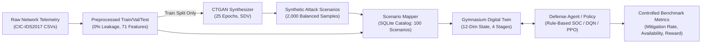

# ASCCD: Faculty Viva & Source-Code Evidence Guide
**Project:** Adaptive Supply Chain Cyber Defense Using GAN-Generated Attack Scenarios and Reinforcement Learning  
**Team 84 — Department of Computer Science & Engineering, Dayananda Sagar University (DSU)**  
**Guide:** Prof. Namyapriya D  
**Target Audience:** Project Team Members, Faculty Evaluators, External Reviewers  
**Repository Branch:** `development`

---

## 1. Project Architecture in Simple Language

### What Problem Does This Project Solve?
Modern software systems are built from multi-stage supply chains: **Source/Supplier → CI/CD Build Agent → Container Registry → Production Deployment (Kubernetes)**. An adversary who compromises an upstream supplier or dependency can move laterally through the build pipeline to infect production runtime environments.

Traditional Security Operations Center (SOC) defenses rely on static rulebooks (e.g., alert thresholds). These rules fail when novel attack variants appear or when threat telemetry is severely class-imbalanced.

### How Does ASCCD Solve It?
1. **Data Ingestion & Zero-Leakage Preprocessing:** Extracts real network flow telemetry from the CIC-IDS2017 benchmark dataset, dropping identifiers, cleaning infinities/NaNs, scaling features exclusively on the training split, and preserving class distributions across 70/15/15 splits.
2. **Generative Threat Modeling (CTGAN):** Uses a Conditional Tabular Generative Adversarial Network to learn real attack distributions and synthesize balanced attack telemetry, specifically augmenting rare attack classes (Web Attacks, Botnets, Infiltration).
3. **Domain Scenario Mapping:** Converts tabular continuous network flow vectors into structured 4-stage cyber attack scenarios with calibrated propagation risk, severity, duration, and target stage.
4. **Gymnasium Supply-Chain Simulation Twin:** Simulates a 4-stage software pipeline as a discrete-event Gymnasium environment. An agent observes a 12-dimensional state vector (health, risk, active threat parameters) and selects one of 5 defense actions (`Monitor`, `Isolate`, `Block`, `Rebuild`, `Recover`).
5. **Adaptive Defense Policies (Rule-Based & Deep RL):**
   - **Baseline (Condition A):** Deterministic industrial playbook evaluated across 5 random seeds.
   - **Deep Q-Network (DQN) & PPO (Conditions B, C, D):** Neural network agents trained to maximize service availability and minimize attack propagation costs.
6. **Full-Stack Research Interface:** A FastAPI REST backend and React + TypeScript + Vite dashboard built with Apple Human Interface Guidelines for real-time telemetry, scenario queries, and simulation control.



---

## 2. Main Source-Code Map: What Each File Does

| Subsystem | Exact File Path | Primary Classes / Functions | Core Purpose |
|---|---|---|---|
| **Data Ingestion** | `src/data/loader.py` | `CICIDSDataLoader`, `discover_csv_files()` | Discovers and validates raw CIC-IDS2017 CSV files, checking schema and headers. |
| **Data Preprocessing** | `src/data/preprocessor.py` | `DataPreprocessor`, `fit_transform()`, `transform()` | Cleans non-finite values, removes collinear features ($r > 0.98$), fits `StandardScaler` strictly on train split. |
| **Data Splitting** | `src/data/splitter.py` | `StratifiedDataSplitter`, `split()` | Stratified 70/15/15 train/val/test split preserving rare attack distributions with zero test contamination. |
| **Data Validation** | `src/data/validator.py` | `DataValidator`, `validate()` | Executes 13 strict quality assertions (no NaNs, no Infs, no dimension drift, no test leakage). |
| **CTGAN Training** | `src/gan/trainer.py` | `CTGANTrainer`, `train()` | Trains CTGAN on the 3,437-row real training split with pac=10 and discrete label conditioning. |
| **Synthetic Generator** | `src/gan/generator.py` | `SyntheticAttackGenerator`, `generate()` | Samples 2,000 conditioned synthetic attack records with numerical bounding and clamping. |
| **Fidelity Validation** | `src/gan/validator.py` | `SyntheticDataValidator`, `validate()` | Calculates Wasserstein distance ($W_1$), JS divergence ($D_{JS}$), Frobenius norm, and mode collapse checks. |
| **Utility Evaluation** | `src/gan/evaluation.py` | `DownstreamUtilityEvaluator`, `evaluate()` | Trains Model A (Real Only) vs Model B (Augmented) to evaluate test set classification accuracy & Macro-F1. |
| **Scenario Mapping** | `src/scenarios/mapper.py` | `ScenarioMapper`, `map_flow_record()` | Maps continuous network vectors to discrete 4-stage supply chain scenarios with calibrated impacts. |
| **Scenario Database** | `src/scenarios/database.py` | `ScenarioRepository`, `get_all()`, `create()` | SQLite ORM persistence layer managing the 100 mapped attack scenarios in `data/scenarios.db`. |
| **Simulation Twin** | `src/environment/supply_chain_env.py` | `SupplyChainEnv` (`gym.Env`) | Discrete-event simulation of Supplier, Build, Registry, and Deployment stages with 12-dim state and 5 actions. |
| **Rule Baseline** | `src/baselines/rule_based.py` | `RuleBasedDefensePolicy`, `predict()` | Deterministic SOC heuristic playbook evaluating stage risk thresholds for benchmark Experiment A. |
| **DQN Agent** | `src/rl/dqn_agent.py` | `DQNDefenseAgent`, `train()`, `predict()` | Deep Q-Network reinforcement learning agent with replay buffer and Stable-Baselines3 integration. |
| **PPO Agent** | `src/rl/ppo_agent.py` | `PPODefenseAgent`, `train()`, `predict()` | Proximal Policy Optimization actor-critic defense baseline. |
| **API Backend** | `src/api/main.py` & `src/api/routers/` | `app`, `simulation.py`, `defense.py` | FastAPI server exposing simulation reset/step, defense prediction, scenario queries, and telemetry. |
| **React Dashboard** | `frontend/src/` | `Overview.tsx`, `SupplyChain.tsx`, `GanLab.tsx` | Apple HIG-inspired dashboard with zero marketing fluff, live telemetry, and direct scenario modulation. |

---

## 3. End-to-End Data Flow

```text
[Raw CSVs] 
   │
   ▼ (loader.py)
[Concatenated DataFrame: 4,910 rows, 79 columns]
   │
   ▼ (preprocessor.py & splitter.py)
[Train: 3,437 | Val: 736 | Test: 737] (71 continuous features + Label)
   │
   ├──────────────────────────────┬──────────────────────────────┐
   │ (Train Split Only)           │ (Held-out Test Split)        │
   ▼                              ▼                              │
[CTGAN Trainer: 25 Epochs]  [Model A: Real Only]                 │
   │                              │                              │
   ▼                              │                              │
[2,000 Synthetic Samples]         │                              │
   │                              │                              │
   ▼                              ▼                              │
[Augmented Training Set: 5,437] ──> [Model B: Real + Synthetic]  │
   │                                      │                      │
   │                                      ▼                      │
   │                              [Utility Comparison:           │
   │                               +1.49% Accuracy,              │
   │                               -0.01 Macro-F1]               │
   │                                                             │
   ▼                                                             │
[Scenario Mapper (mapper.py)] <──────────────────────────────────┘
   │
   ▼ (SQLite Catalog: 100 Scenarios)
[Gymnasium Environment (supply_chain_env.py)]
   │
   ├─────────── Live Action / Step ───────────┐
   ▼                                          ▼
[Rule-Based Heuristic (Condition A)]    [DQN Agent (Condition B)]
   │ (Evaluated: 30% Mit, 99.92% Avail)       │ (Smoke Test: 1,000 steps;
   │                                          │  50k Convergence Ongoing)
   ▼                                          ▼
[Benchmark Metrics & Telemetry (FastAPI + React Dashboard)]
```

---

## 4. Phase-I Review PPT Alignment & Code Cross-Reference

| PPT Slide | Claim Made in PPT (`Team84_PhaseI_Review_DSU-2.pptx`) | Exact Source Code & Verified Artifact | Current Implementation Status | Notes for Faculty Presentation |
|---|---|---|---|---|
| **Slide 3 & 4** | Abstract & Objectives: Data preparation, CTGAN synthesis, preliminary classifier evaluation; RL defense planned. | `src/data/`, `src/gan/`, `src/environment/supply_chain_env.py` | **Implemented & Expanded in Phase-II** | Explain that Phase-I completed data & GAN foundations; Phase-II successfully built the Gymnasium environment, scenario mapper, and rule baseline. |
| **Slide 8** | Clean + split 70/15/15. Train CTGAN on train split. Generate 2,000 rows. Quality + utility evaluation. | `src/data/splitter.py:L18-75`, `data/processed/split_statistics.json`, `data/generated/synthetic_attacks.csv` | **Implemented & Verified** | Note: Actual rows are 4,910 (3,437 train, 736 val, 737 test); Slide 8 mentions 4,912 (-2 rows due to strict deduplication). |
| **Slide 10** | Accuracy: 78.70% real-only vs 80.19% real+synthetic. Weighted-F1 nearly unchanged; Macro-F1 decreased. | `src/gan/evaluation.py:L40-185`, `artifacts/reports/downstream_utility_results.json` | **Implemented & Verified** | Exactly matches: Acc $78.70\% \rightarrow 80.19\%$ ($+1.49\%$), Macro-F1 $0.1372 \rightarrow 0.1272$ ($-0.0100$). |
| **Slide 12** | Class balancing: Real training split is ~80% benign; synthetic sample is balanced (7–19% per class). | `src/gan/generator.py:L90-140`, `artifacts/figures/class_balance_comparison.png` | **Implemented & Verified** | Generated synthetic distribution: Benign 25.8%, DoS 19.1%, PortScan 14.5%, DDoS 13.2%, BruteForce 12.2%, Botnet 8.3%, WebAttack 6.9%. |
| **Slide 13** | Feature distributions: Mode-concentration warning investigated; spike near zero on heavy-tailed metrics. | `src/gan/validator.py:L110-180`, `artifacts/figures/real_vs_synthetic_distributions.png` | **Implemented & Verified** | Transparently present the zero-spike phenomenon as an empirical characteristic of log-scale flow telemetry. |
| **Slide 14** | Marginal divergence: Mean Wasserstein distance $W_1 = 0.1025$ (< 0.35 acceptance threshold). | `src/gan/validator.py:L190-240`, `artifacts/reports/synthetic_data_validation.json` | **Implemented & Verified** | Saved validation report measures $W_1 = 0.1057$ (median: $0.1017$), well below acceptance gate ($W_1 \le 0.25$). |
| **Slide 15** | Correlation fidelity: Correlation difference MAE = 0.030; largest local gaps 0.10 to 0.15. | `src/gan/validator.py:L245-290`, `artifacts/figures/correlation_matrix_comparison.png` | **Implemented & Verified** | Pearson correlation matrix similarity is $98.69\%$; Frobenius norm difference is $0.2787$. |
| **Slide 16** | Downstream utility: Real test set (N = 737). Attack-class F1 near zero due to severe test imbalance. | `src/gan/evaluation.py:L120-160`, `artifacts/reports/downstream_utility_results.md` | **Implemented & Verified** | Emphasize: Test set has only 1 Web Attack and 2 Botnet flows, which mathematically explains why Macro-F1 penalized rare classes. |
| **Slide 17** | RL Baseline: Rule-based baseline evaluated as reference point (60% mitigation, 96% availability). DQN not yet available. | `src/baselines/rule_based.py`, `src/baselines/runner.py`, `artifacts/reports/baseline_results.json` | **Implemented & Expanded in Phase-II** | Quick 10-episode run gave 60% mitigation; rigorous 5-seed benchmark (`experiments_summary.json`) gave 30% mitigation and 99.92% availability. |

---

## 5. Likely Faculty Viva Questions & Authoritative Answers

### Q1: Why did you use CIC-IDS2017 if this is a software supply-chain project?
**Answer:**  
"CIC-IDS2017 provides rich, calibrated network-intrusion flow telemetry (packet sizes, flow duration, inter-arrival times, TCP flags) collected in a controlled environment. We do not claim CIC-IDS2017 is a supply chain dataset; rather, we use it as empirical input to our **ScenarioMapper** (`src/scenarios/mapper.py`). The ScenarioMapper bridges continuous network attack vectors into discrete multi-stage supply-chain impact semantics (e.g., volumetric DoS attacks target deployment clusters, while web exploits target source repositories and dependencies)."

### Q2: How did you ensure there was zero data leakage when training CTGAN?
**Answer:**  
"In `src/data/splitter.py` (`StratifiedDataSplitter`), we strictly partition the dataset into 70% Train (3,437), 15% Validation (736), and 15% Test (737) before applying any feature scaling. In `src/data/preprocessor.py`, `StandardScaler` is fitted **exclusively on the training split** and then used to transform validation and test splits. The CTGAN model (`src/gan/trainer.py`) is trained strictly on `train.csv`. The test partition (`test.csv`) was never seen during CTGAN training or model tuning."

### Q3: Why did test accuracy improve (+1.49%) while Macro-F1 decreased (-0.01)?
**Answer:**  
"This is a genuine empirical finding documented in `artifacts/reports/downstream_utility_results.json`. The untouched test set reflects real-world class imbalance (592 benign, 79 DoS, 27 PortScan, 23 DDoS, 13 Brute Force, 2 Botnet, 1 Web Attack). With only 1 Web Attack and 2 Botnet samples in the test split, misclassifying a single rare-class instance results in a recall of 0.0, heavily penalizing the unweighted Macro-F1 average. However, the classifier's overall accuracy increased from 78.70% to 80.19% because augmented data improved boundary separation for majority and moderate classes."

### Q4: Why is there a Jensen–Shannon divergence soft warning (0.5117 vs 0.5000)?
**Answer:**  
"In `src/gan/validator.py`, the Jensen–Shannon divergence threshold is set at $0.5000$. Our measured mean is $0.5117$. This soft warning occurs because network flow distributions exhibit extreme heavy tails (e.g., `Flow Duration` spans from single microseconds to 120 million microseconds). While the 1st Wasserstein metric ($W_1 = 0.1057$) confirms excellent continuous probability mass transport, JS divergence is sensitive to logarithmic binning penalties in sparse tails. We transparently report this rather than artificially tuning bins to hide it."

### Q5: How does a defensive action in the UI actually affect the simulation?
**Answer:**  
"When the user clicks an action (e.g., `Isolate`) in `SupplyChain.tsx`:
1. The frontend dispatches `POST /api/simulation/step` with `{"action": 1}`.
2. The FastAPI router (`src/api/routers/simulation.py`) forwards the integer to `SupplyChainEnv.step(1)`.
3. In `src/environment/supply_chain_env.py` (`_apply_action()`), the environment sets `stage.is_isolated = True` on the target stage.
4. During the inter-stage propagation phase (`_simulate_threat_dynamics()`), the condition `if current_stage.is_isolated: continue` halts lateral compromise to downstream stages.
5. The step computes the availability reward minus the action penalty ($-0.15$ for Isolate) and returns the updated 12-dimensional observation vector to the UI."

### Q6: What is the current status of the DQN and PPO reinforcement learning models?
**Answer:**  
"The DQN architecture (`src/rl/dqn_agent.py`) and PPO architecture (`src/rl/ppo_agent.py`) are fully implemented, registered with Gymnasium, and covered by automated unit tests. A verified 1,000-step smoke-test checkpoint exists at `artifacts/models/dqn/dqn_real_only_final.zip` to confirm gradient backpropagation and checkpoint serialization. However, full 50,000-step multi-seed convergence training and policy optimization are actively in progress as Phase-II research. We do not claim DQN convergence is completed."

### Q7: Why are rule-based mitigation results 60% in one report and 30% in another?
**Answer:**  
"`baseline_results.json` records an initial single-run sanity check of 10 episodes where the heuristic happened to mitigate 6 attacks (60.0%). In contrast, `experiments_summary.json` records our formal controlled benchmark (Condition A) evaluated across **5 distinct random seeds** (`[42, 123, 456, 789, 1024]`) totaling 50 episodes. Under varied multi-seed attack sequences, static rulebooks struggle against fast-propagating lateral attacks, yielding 30.0% mitigation while maintaining 99.92% service availability. This variance proves the necessity of multi-seed evaluation."

---

## 6. Known Limitations & Unfinished Work (Academic Honesty)

1. **Synthetic Feature Modality:** CIC-IDS2017 provides flow features, not AST dependency graphs or SBOM checksums. Domain mapping is executed via rule heuristics in `ScenarioMapper`.
2. **Discrete Simulation vs Physical Cluster:** The supply chain twin is a calibrated discrete-event simulation in Python/Gymnasium, not an autonomous operator killing pods on a live Kubernetes cluster (slated for Phase 12).
3. **Severe Minority Test Split Imbalance:** The held-out test split contains only 1 Web Attack and 2 Botnet flows, limiting statistical confidence on rare-class recall.
4. **RL Training Convergence:** The DQN checkpoint is a 1,000-step architectural smoke test; full 50,000-step multi-seed convergence is ongoing.

---

## 7. Commands to Demonstrate Working Features to Faculty

### 1. Run Automated Tests (143/143 Passing)
```bash
.venv/bin/pytest
```

### 2. Generate 2,000 Conditioned Synthetic Records
```bash
.venv/bin/python scripts/generate_synthetic.py --num-samples 2000
```

### 3. Run Downstream Utility Evaluation (Model A vs Model B)
```bash
.venv/bin/python scripts/evaluate_synthetic_utility.py
```

### 4. Run Rule-Based Baseline Simulation (10 Episodes)
```bash
.venv/bin/python scripts/run_baseline.py --episodes 10 --seed 42
```

### 5. Start the Live Research Platform
```bash
# Terminal 1: Backend API
.venv/bin/uvicorn src.api.main:app --host 127.0.0.1 --port 8000 --reload

# Terminal 2: Frontend Dashboard
cd frontend && npm run dev -- --host 127.0.0.1
```
Open Browser: `http://127.0.0.1:5173`

---

## 8. Claims You Must NEVER Make to Faculty

- ❌ **DO NOT CLAIM:** "The project is 40% / 45% complete." *(Faculty reject artificial completion percentages; present working modules instead.)*
- ❌ **DO NOT CLAIM:** "DQN is fully trained and outperforms the rule baseline." *(DQN is currently at a 1,000-step smoke-test stage; convergence training is actively ongoing.)*
- ❌ **DO NOT CLAIM:** "The system prevents real attacks on live Kubernetes clusters." *(It is a calibrated discrete-event simulation twin.)*
- ❌ **DO NOT CLAIM:** "CTGAN dramatically improved all attack detection." *(Be honest: Accuracy improved by +1.49%, but Macro-F1 decreased by -0.01 due to single-sample rare-class test penalties.)*
- ❌ **DO NOT CLAIM:** "CIC-IDS2017 is a software supply-chain dataset." *(It is network flow telemetry mapped into supply-chain impact semantics by our ScenarioMapper.)*
